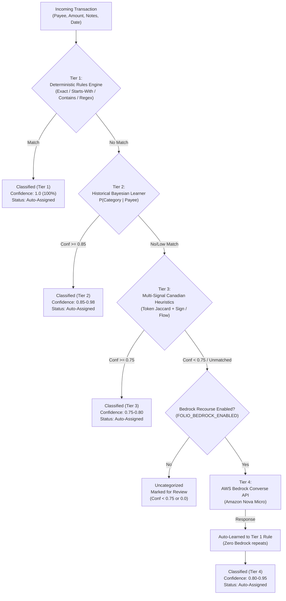
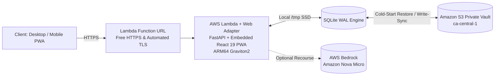

# Folio

Folio is a self-hosted personal finance tracking, statement ingestion, and household budgeting application. Built with **FastAPI**, **SQLite (WAL mode)**, and a **React 19 + Vite + Tailwind CSS PWA**, it is engineered for high performance on desktop and mobile, with optional zero-cost AWS SAM serverless deployment in `ca-central-1`.

Folio combines high-density desktop statement parsing and data entry with responsive mobile consultation (charts, budget meters, net worth progression), tailored for Canadian and North American households.

---

## Table of Contents

- [Core Capabilities](#core-capabilities)
  - [1. Multi-Tier Auto-Classification Engine](#1-multi-tier-auto-classification-engine)
  - [2. Canadian Personal Finance & Household Collaboration](#2-canadian-personal-finance--household-collaboration)
  - [3. Dedicated Goals & CRA Contribution Tracking](#3-dedicated-goals--cra-contribution-tracking)
  - [4. Envelope Budgeting & Cash Flow Trajectory Forecasting](#4-envelope-budgeting--cash-flow-trajectory-forecasting)
  - [5. Multi-Format Statement Ingestion & Deduplication](#5-multi-format-statement-ingestion--deduplication)
  - [6. Investment Performance & Portfolio Analytics](#6-investment-performance--portfolio-analytics)
  - [7. Exact Minor-Unit Money Architecture](#7-exact-minor-unit-money-architecture)
  - [8. Interactive Ledger & Transfer Pairing](#8-interactive-ledger--transfer-pairing)
  - [9. Built-in Canadian Demo Dataset](#9-built-in-canadian-demo-dataset)
- [Architecture](#architecture)
- [Quick Start (Local Development)](#quick-start-local-development)
  - [Prerequisites](#prerequisites)
  - [1-Command Local Launcher](#1-command-local-launcher)
  - [First Run: Master Passphrase Vault](#first-run-master-passphrase-vault)
  - [Database Migrations & Maintenance](#database-migrations--maintenance)
- [Running Automated Tests](#running-automated-tests)
- [CI/CD & Automated Security](#cicd--automated-security)
- [Docker Compose Setup](#docker-compose-setup)
- [Security & Zero-Trust Architecture](#security--zero-trust-architecture)
- [AWS SAM Serverless Deployment (True $0.00/mo Baseline)](#aws-sam-serverless-deployment-true-000mo-baseline)
- [Configuration Reference](#configuration-reference)
- [License](#license)

---

## Core Capabilities

### 1. Multi-Tier Auto-Classification Engine

Folio features an offline-first, 4-tier cascading auto-classification engine that automatically categorizes incoming transactions, learns from historical user choices, and optionally recurses to cloud AI for ambiguous merchants.



#### The Four Tiers Explained

- **Tier 1 — Deterministic Rules Engine**:
  - Evaluates user-defined and default rules using `EXACT`, `STARTS_WITH`, `CONTAINS`, and safe bounded `REGEX` pattern matching.
  - Prioritized by numeric rank (lower number = higher priority).
  - Matches execute in $< 1\text{ ms}$ with **100% confidence**.
  - Seeded with 250+ North American and Canadian merchant patterns (Costco, Loblaws, Metro, Sobeys, Hydro-Québec, Bell, Rogers, Telus, SAQ, LCBO, Petro-Canada, Tim Hortons, etc.).

- **Tier 2 — Historical Bayesian Frequency Learner**:
  - Dynamically calculates the empirical probability distribution $P(\text{Category} \mid \text{Payee})$ across your ledger history.
  - Scales confidence by sample size:
    $$N=1 \rightarrow 85\%, \quad N=2 \rightarrow 90\%, \quad N \ge 3 \rightarrow 95\%-98\%$$
  - Includes fallback token-overlap matching for recurring merchants with branch/terminal numbers (e.g. `TIM HORTONS #4122` matches `TIM HORTONS #102`).

- **Tier 3 — Multi-Signal Canadian & US Household Heuristics**:
  - 22 granular Canadian and US household categories with bilingual English and French keyword dictionaries.
  - Token-set fuzzy **Jaccard distance** matching with typo tolerance (e.g., `COSTMART` or `WAL-MRTT`).
  - Cashflow directional validation: distinguishes positive inflows (payroll, government benefits, GST credits) from negative outflows (utilities, subscriptions, bank fees).

- **Tier 4 — Optional AWS Bedrock AI Recourse (Zero Recurring Cost)**:
  - If a novel or ambiguous merchant cannot be resolved locally, Folio can optionally recurse to the AWS Bedrock Converse API using **Amazon Nova Micro** (`amazon.nova-micro-v1:0`) or Claude 3 Haiku in `ca-central-1`.
  - **Zero-Repeat Self-Learning**: When Bedrock successfully classifies an unrecognized merchant, Folio automatically stores a new Tier 1 exact rule in SQLite. Bedrock is **never invoked twice** for the same merchant pattern.
  - **Graceful Offline Fallback**: If AWS credentials, Bedrock access, or network are unavailable, the engine gracefully continues using local tiers without throwing errors.

#### Interactive Sandbox & Batch Operations

- **Classification Engine & Sandbox Tab**: Located in the Rules Manager, providing a real-time diagnostic playground with a live confidence meter, tier badges, matched pattern preview, and decision explanations.
- **1-Click Batch Auto-Classification**: Detects all uncategorized ledger transactions and classifies them in bulk with configurable minimum confidence thresholds (e.g. auto-assign $\ge 0.75$, flag $< 0.75$ for review).

---

### 2. Canadian Personal Finance & Household Collaboration

Folio is architected for Canadian legal, tax, and banking realities:

- **Multi-Member Collaborative Vault**:
  - Supports multi-user household collaboration with entities (`HouseholdMember`).
  - Canadian statutory ownership rules: Registered accounts (**TFSA**, **RRSP**, **FHSA**, **RESP**) are legally individual, while **Chequing**, **Savings**, and **Mortgages** support joint ownership.
  - Granular household member filtering across the ledger, account balances, and goal tracking.

- **Canadian Mortgage Mathematics**:
  - Implements **semi-annual compounding, not in advance**, as mandated by the Canadian *Interest Act* (s. 6), rather than the US monthly compounding convention. Using US mathematics overstates Canadian mortgage interest by thousands over a 25-year amortization.
  - Month-by-month principal, interest, and escrow (property tax and insurance) amortization schedules.
  - Supports switching to `MONTHLY` compounding for US mortgages and loans.

- **Automated TSX Market Quotes & Bank of Canada Valet FX**:
  - Automated, zero-cost price quotes for Toronto Stock Exchange (TSX) and TSX Venture (`.TO`, `.V`) equities and ETFs.
  - Integration with the official **Bank of Canada Valet API** for daily USD/CAD exchange rates (`FXUSDCAD`) and automated portfolio revaluation.
  - 100% privacy-preserving: no third-party financial aggregators or paid API keys required.

---

### 3. Dedicated Goals & CRA Contribution Tracking

Folio provides statutory tracking for Canadian tax-advantaged accounts:

- **CRA Statutory Contribution Limits**:
  - **TFSA (Tax-Free Savings Account)**: Tracks the 2026 statutory annual limit ($7,000) with historical room accounting.
  - **FHSA (First Home Savings Account)**: Tracks the $8,000 annual contribution room and $40,000 lifetime cap.
  - Overcontribution warning indicators alerting users before triggering the CRA 1%/month penalty tax.

- **Interactive Emergency Fund Auto-Calculator**:
  - Models **3, 6, 9, or 12 months** of survival cash cushion based on trailing historical monthly expenses.
  - **Discretionary Category Exclusion**: Interactive checkboxes allow toggling off non-essential lifestyle categories (Dining Out, Travel, Shopping) to model lean survival targets versus standard lifestyle targets.
  - Links directly to liquid cash accounts (e.g. High Interest Savings Accounts).

---

### 4. Envelope Budgeting & Cash Flow Trajectory Forecasting

- **Envelope Budgeting with Rollovers**:
  - Category-by-category rollover toggle (`is_rollover`).
  - Surplus savings roll forward into next month's envelope to cushion upcoming expenses.
  - Deficits (overspending) strictly reduce next month's available cushion, preventing budget leakage.

- **30/60/90-Day Cash Flow Trajectory Simulation**:
  - Dynamic forward-looking trajectory modeling Canadian 26-pay-period bi-weekly, semi-monthly, and monthly payroll cycles alongside debt and mortgage amortization schedules.
  - Real-time zero-liquidity floor detection and advance cash deficit warning alerts.

- **Interactive Sankey Cashflow Diagram**:
  - Visualizes monthly income flowing into expense categories and net savings.
  - Internal transfers (credit card payments and inter-account transfers) are automatically identified and separated so cash flow summaries reflect true external expenditures.

---

### 5. Multi-Format Statement Ingestion & Deduplication

- **CSV Auto-Detection**:
  - Auto-detects delimiters (comma, semicolon, tab) and column layouts across major Canadian institutions (RBC, TD, BMO, Scotiabank, CIBC, Desjardins, National Bank, Tangerine, EQ Bank, Wealthsimple) and US/Global banks (`Debit`, `Credit`, `Amount`, `Description 1`, `Description 2`).
- **PDF Bank Statements**:
  - Tabular transaction and text pattern extraction using `pdfplumber` for credit cards and chequing accounts.
- **OFX / QFX / QBO Formats**:
  - Direct ingestion of bank export formats via `ofxtools`.
- **Zero-Duplicate Import Engine**:
  - Deterministic SHA-256 fingerprinting per transaction:
    $$\text{SHA-256}(\text{account\_id} \mid \text{date} \mid \text{amount\_cents} \mid \text{raw\_payee})$$
  - Filters out duplicate rows across overlapping statement imports.

---

### 6. Investment Performance & Portfolio Analytics

- **Holdings, Lots & Cost Basis**:
  - Individual purchase lot tracking with cost basis and disposal accounting.
  - Fractional-share precision (`Numeric(28, 8)`) for modern brokers and crypto.
- **Dual Performance Analytics**:
  - **Time-Weighted Return (TWR)**: Measures investment selection performance independent of cash flow timing.
  - **Money-Weighted Return (MWR / XIRR)**: Measures your actual portfolio return including the timing and magnitude of your deposits and withdrawals.
  - Reported across 1M, 3M, YTD, 1Y, and all-time windows.
- **Capital vs. Growth Breakdown**:
  - Distinguishes cumulative net contributions from market appreciation.

---

### 7. Exact Minor-Unit Money Architecture

- All monetary values are stored in the database as exact integer minor units (**cents**).
- Eliminates floating-point rounding errors (`0.1 + 0.2 = 0.30000000000000004`) across loan amortization schedules, budget balances, and transaction totals.
- The HTTP API accepts and emits decimal dollars for seamless integration.

---

### 8. Interactive Ledger & Transfer Pairing

- High-density desktop transaction table and mobile-optimized card feed.
- Multi-split transactions (e.g. mortgage payment split between principal, interest, and escrow).
- **Automated Transfer Pairing**: Identifies offsetting transactions between accounts (e.g. Chequing debit and Visa credit), linking them via `transfer_transaction_id` so they do not artificially inflate income or expenses.
- Inline category editing, merchant pattern rules creation, and batch categorization.

---

### 9. Built-in Canadian Demo Dataset

Folio includes a comprehensive Canadian household demo dataset that can be loaded on first launch or generated via `POST /api/maintenance/seed-demo-data`:

- **Household Members**: Michael (Self) & Sarah (Partner).
- **7 Canadian Accounts**: RBC Joint Chequing, EQ Bank Emergency HISA, Wealthsimple TFSA, TD Direct Investing RRSP, RBC Avion Visa Infinite, Desjardins Fixed Mortgage, and Toyota Financial Auto Loan.
- **150+ Realistic Ledger Entries**: Spread across the past 90 days with dynamic relative dates, paired transfers, mortgage splits, and bi-weekly payrolls.
- **20 Curated Uncategorized Showcase Transactions**: Recent transactions explicitly curated to demonstrate each tier of the auto-classification engine (Tier 1 rules, Tier 2 historical learning, Tier 3 Canadian heuristics, and Tier 4 Bedrock recourse).
- **Net Worth History**: 6 months of reconstructed daily balance snapshots for immediate trend visualization.

---

## Architecture

Folio uses a unified deployment model. The React 19 PWA is compiled in a multi-stage Docker build and served directly by FastAPI on port 8000, eliminating CORS issues and secondary CDN hosting requirements.



---

## Quick Start (Local Development)

### Prerequisites

- **Python 3.14** (used in CI, container image, and local development)
- **Node.js 22.12+ or 20.19+** and **npm**

### 1-Command Local Launcher

Launch both the FastAPI backend and Vite frontend with hot-reloading:

```powershell
.\dev.ps1
```

This initializes the virtual environment, installs requirements, starts the backend on `http://localhost:8000`, the frontend on `http://localhost:5173`, and opens your browser.

### First Run: Master Passphrase Vault

There is no default password. Authentication is fail-closed, so with nothing configured the app starts normally and rejects API requests.

On first run, `dev.ps1` prompts for a master passphrase, bcrypt-hashes it locally, and writes only the hash to `backend/.env` (gitignored). Subsequent runs pick it up automatically.

```powershell
.\dev.ps1 -SetPassword   # Change the local master passphrase
.\dev.ps1 -Clean         # Wipe database and uploads to start fresh (passphrase is preserved)
```

To generate a bcrypt hash manually:

```powershell
"your passphrase" | python backend\scripts\hash_password.py
```

### Database Migrations & Maintenance

The schema is managed by Alembic and upgraded automatically on startup.

```powershell
cd backend
.\.venv\Scripts\python.exe -m alembic current      # Show applied revision
.\.venv\Scripts\python.exe -m alembic upgrade head # Apply pending migrations
```

One-shot maintenance operations for existing installations:

```
POST /api/maintenance/seed-demo-data?force=true      # Seed Canadian demo dataset
POST /api/maintenance/backfill-snapshots?months=24   # Reconstruct net worth history
POST /api/maintenance/detect-transfers               # Pair historical transfers
```

---

## Running Automated Tests

Run the complete 3-phase automated test suite (Backend Pytest + Frontend Vitest with `happy-dom` + TypeScript typecheck & production build) in 1 command:

```powershell
.\test.ps1
```

---

## CI/CD & Automated Security

Folio includes automated GitHub Actions workflows:

- **Continuous Integration ([`.github/workflows/ci.yml`](.github/workflows/ci.yml))**: Runs Pytest (181 tests), Vitest (35 unit tests), `tsc -b`, and Vite production bundle on every commit.
- **CodeQL Security Analysis ([`.github/workflows/codeql.yml`](.github/workflows/codeql.yml))**: Static application security testing (SAST) for Python and TypeScript.
- **Gitleaks Secret Scanner ([`.github/workflows/secret-scan.yml`](.github/workflows/secret-scan.yml))**: Scans commits for exposed secrets, tokens, or private keys.
- **Dependabot ([`.github/dependabot.yml`](.github/dependabot.yml))**: Automated weekly grouped updates for `pip`, `npm`, and GitHub Actions.

---

## Docker Compose Setup

Run the unified single-container build (FastAPI + embedded PWA + SQLite):

```powershell
docker compose up --build
```

Access the application at `http://localhost:8000`.

---

## Security & Zero-Trust Architecture

Folio implements an enterprise-grade defense-in-depth security model engineered for hosting financial data:

- **Dual-Auth Identity Engine**:
  - **AWS Cognito User Pool (Production Cloud)**: Zero-Trust OpenID Connect / JWKS cryptographic token validation, Admin-only user provisioning (`AllowAdminCreateUserOnly: true`), robust password policies, and optional **TOTP Software Token MFA** with 50,000 free monthly active users.
  - **Master Passphrase Vault (Local / Docker)**: Protected by bcrypt hashing, constant-time comparisons (`secrets.compare_digest`), and signed `HttpOnly`, `SameSite=Lax`, `Secure` JWT session cookies.
- **Fail-Fast Production Validation**: Refuses to start in production if using development signing keys or plaintext passwords.
- **Login Rate Limiting**: Sliding-window rate limiter bounding online brute-force guessing against the master passphrase.
- **Bounded User-Supplied Regex**: Categorization rules accepting regular expressions are length-limited and screened for nested quantifiers to prevent ReDoS (catastrophic backtracking).
- **Edge Perimeter Protection**: Lambda Function URL is protected with origin secret verification (`X-Folio-Origin-Verify`) to ensure traffic flows through CloudFront CDN / AWS WAF.
- **Modern Security Headers**: Full injection of `Content-Security-Policy` (CSP), `X-Frame-Options: DENY`, `X-Content-Type-Options: nosniff`, and `Permissions-Policy`.
- **Transactional S3 Vault Encryption**: Private S3 database snapshots are uploaded with Server-Side Encryption (`AES256`). Snapshots are debounced to coalesce edits into single atomic uploads.
- **Container Non-Root Isolation**: Multi-stage Docker execution runs as an unprivileged `appuser` (UID 1000).

---

## AWS SAM Serverless Deployment (True $0.00/mo Baseline)

Folio includes a native AWS SAM template (`template.yaml` + `Dockerfile`) utilizing the **AWS Lambda Web Adapter** on ARM64 Graviton2 with direct **Lambda Function URLs** and Cognito User Pools:

### 1-Command SAM Deployment

```powershell
.\deploy.ps1 -Region ca-central-1 -StackName folio-prod
```

### Serverless Architecture Highlights

1. **Lambda Web Adapter**: Runs the standard FastAPI app and compiled React 19 PWA directly inside AWS Lambda without code changes.
2. **Lambda Function URL**: Direct HTTPS endpoint with automated TLS and free CORS (bypassing API Gateway fees).
3. **AWS Cognito User Pool**: Manages owner identity, credentials, and TOTP MFA tokens.
4. **Single-Writer SQLite Locking**: Configured with `ReservedConcurrentExecutions: 1` to guarantee database file integrity.
5. **Automated S3 Sync**: Restores `folio.db` on cold-start and checkpoints debounced snapshots back to the private S3 vault.
6. **Optional AWS Bedrock Recourse**: Scoped IAM permissions allowing Amazon Nova Micro invocation when `EnableBedrock` is set to `'true'`.
7. **Cost**: **$0.00/month** baseline within the AWS Lambda Always-Free Tier (1M requests/month) + Cognito (50,000 free MAUs) + S3 standard storage.

---

## Configuration Reference

| Environment Variable | SAM Parameter | Default | Description |
| :--- | :--- | :--- | :--- |
| `ENVIRONMENT` | — | `development` | Runtime mode: `development` or `production` |
| `FOLIO_DEFAULT_CURRENCY` | — | `CAD` | Default currency for new accounts and transactions |
| `FOLIO_MASTER_PASSWORD_HASH` | — | `""` | Bcrypt hash of the master passphrase |
| `FOLIO_BEDROCK_ENABLED` | `EnableBedrock` | `false` | Enable Tier 4 AWS Bedrock AI auto-classification |
| `FOLIO_BEDROCK_MODEL_ID` | `BedrockModelId` | `amazon.nova-micro-v1:0` | AWS Bedrock model identifier (e.g. Nova Micro, Claude 3 Haiku) |
| `FOLIO_BEDROCK_REGION` | — | `ca-central-1` | AWS region for Bedrock Converse API calls |
| `FOLIO_CLASSIFICATION_THRESHOLD`| — | `0.75` | Minimum confidence score for automatic category assignment |
| `COGNITO_USER_POOL_ID` | Output from SAM | `""` | AWS Cognito User Pool ID |
| `COGNITO_CLIENT_ID` | Output from SAM | `""` | AWS Cognito App Client ID |
| `S3_BUCKET_NAME` | Generated by SAM| `""` | Private S3 vault bucket for database backups |
| `FOLIO_ORIGIN_VERIFY_SECRET` | `OriginVerifySecret` | `""` | Shared secret header required when fronted by CloudFront / WAF |
| `FOLIO_CORS_ORIGINS` | `AllowedOrigin` | `""` | Allowed CORS origins (only needed when using separate domains) |

---

## License

MIT. Copyright (c) 2026 Michael Sanford. See [LICENSE](LICENSE).
